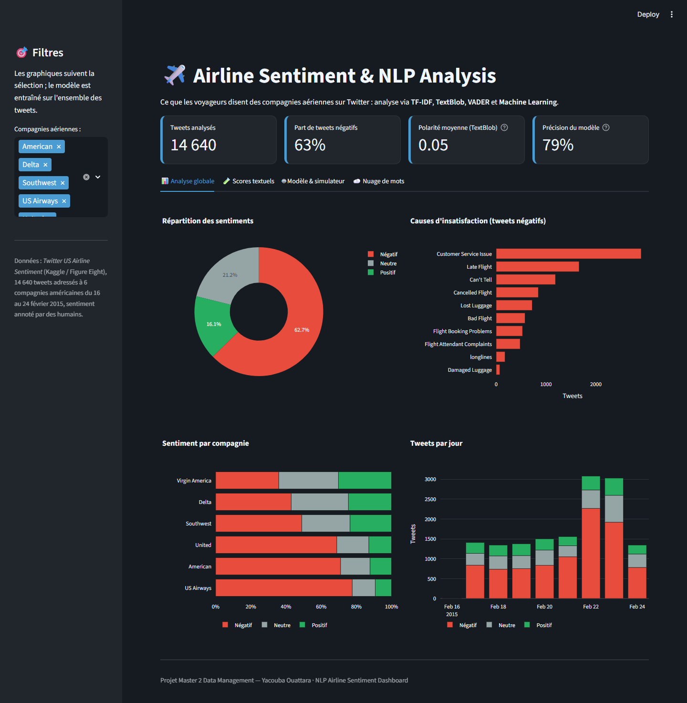
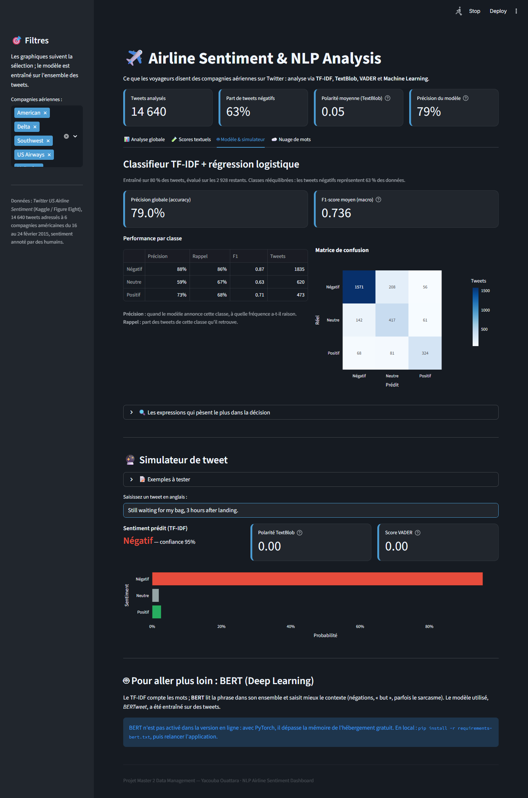

# ✈️ Airline Sentiment & NLP Analysis

Ce que les voyageurs disent des compagnies aériennes américaines sur Twitter : un tableau de bord Streamlit qui analyse 14 640 tweets, compare des méthodes de lexique (TextBlob, VADER) à un modèle supervisé (TF-IDF + régression logistique) et permet de tester ses propres tweets.

**Application en ligne : https://airline-sentiment-oy.streamlit.app** · [ouvrir directement le simulateur](https://airline-sentiment-oy.streamlit.app/?onglet=modele)



## Ce que fait l'application

| Onglet | Contenu |
|---|---|
| Analyse globale | Répartition des sentiments, causes d'insatisfaction, sentiment par compagnie, volume par jour |
| Scores textuels | Polarité et subjectivité (TextBlob), benchmark par compagnie, accord des lexiques avec les annotations humaines |
| Modèle & simulateur | Précision, F1 par classe, matrice de confusion, expressions les plus décisives, simulateur de tweet |
| Nuage de mots | Mots dominants par sentiment, sans @mentions ni liens |

Les filtres par compagnie s'appliquent aux graphiques ; le modèle est entraîné une fois sur l'ensemble des tweets.
Lien direct vers un onglet : `?onglet=global`, `?onglet=scores`, `?onglet=modele` ou `?onglet=nuage`.

## Résultats

| Méthode | Accord avec les annotations humaines |
|---|---|
| TextBlob (lexique) | 45 % |
| VADER (lexique, conçu pour les réseaux sociaux) | 49 % |
| **TF-IDF + régression logistique** | **79 %** (F1 macro 0,736, sur 2 928 tweets de test) |

- Les lexiques notent les mots un par un : « Still waiting for my bag, 3 hours after landing » n'a aucun mot négatif et obtient un score de 0, alors que le modèle supervisé y reconnaît une plainte à 95 %.
- Choix qui ont amélioré le modèle de départ (F1 macro 0,693 → 0,736) : retirer @mentions et liens, garder les mots de négation (« not », « no » étaient supprimés avec les *stop words*), utiliser des paires de mots, rééquilibrer les classes (63 % de tweets négatifs).
- Limite assumée : le sarcasme (« Oh great, another 3 hours delay ») trompe aussi bien les lexiques que le TF-IDF.



## Lancer en local

```bash
pip install -r requirements.txt
streamlit run app.py
```

Option **BERT** (Deep Learning, modèle *BERTweet*) pour comparer avec le TF-IDF dans le simulateur :

```bash
pip install -r requirements-bert.txt
```

BERT n'est pas activé dans la version en ligne : avec PyTorch, il dépasse la mémoire de l'hébergement gratuit de Streamlit Community Cloud.

## Données

[Twitter US Airline Sentiment](https://www.kaggle.com/datasets/crowdflower/twitter-airline-sentiment) (Figure Eight / Kaggle, licence CC BY-NC-SA 4.0) : tweets adressés à six compagnies américaines du 16 au 24 février 2015, sentiment annoté par des contributeurs humains.

## Stack

Python · Streamlit · pandas · scikit-learn · Plotly · TextBlob · VADER · WordCloud · (option) Hugging Face Transformers

---

Projet de Master 2 Data Management — Yacouba Ouattara · [Portfolio](https://portfolio-umber-alpha-cap35chbad.vercel.app) · [LinkedIn](https://www.linkedin.com/in/yacouba-ouattara-b7156a178/)
